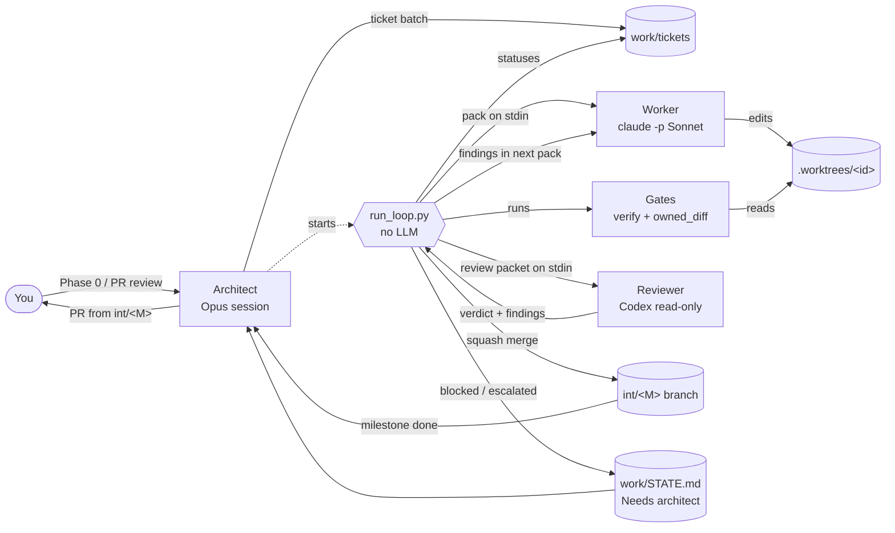
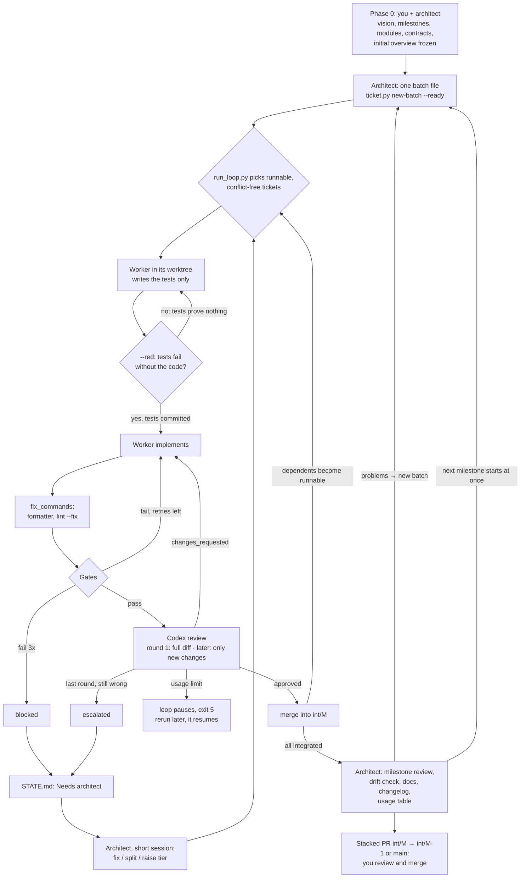
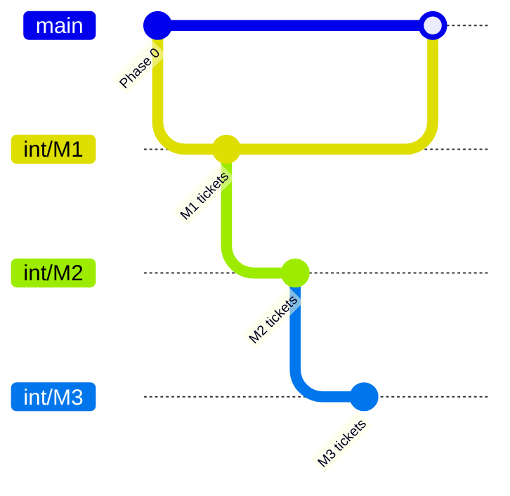
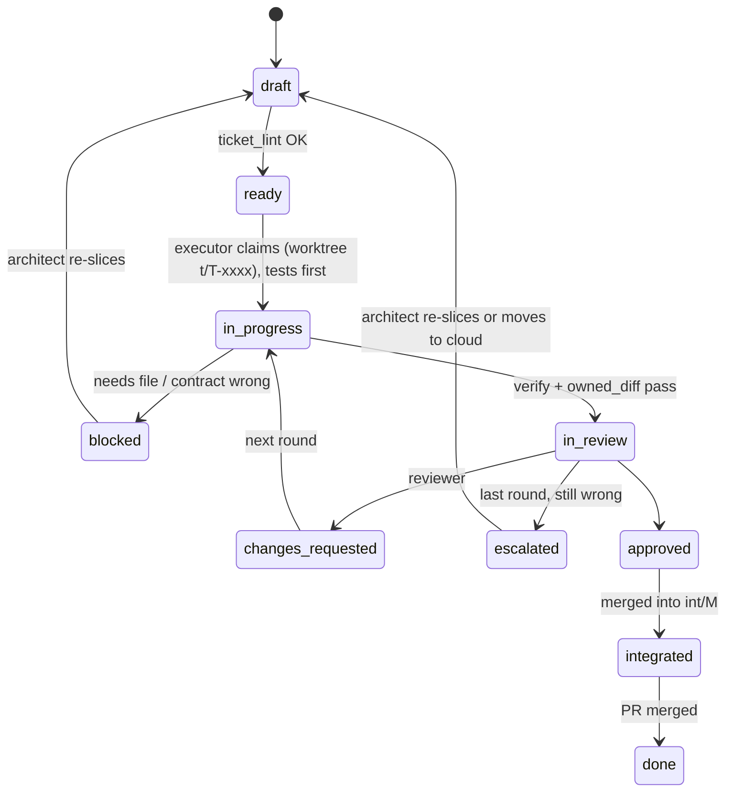

# How the AI agents work on this repo
<!-- Human documentation for the process itself. Stable; changes only when the process changes. -->

## Roles
| Role | Default tool / model | Started by | Sees | Writes |
|---|---|---|---|---|
| Human | you | — | everything, at PR time | `vision.md`, freezes `initial-overview.md`, approves `AGENTS.md`, config and ADRs |
| Architect / tech lead | Claude Code on Opus | you, one short session per job | whole repo, on demand | plan, contracts, ticket batches, fixes for blocked tickets, milestone review, docs, PR |
| Loop (`run_loop.py`) | plain Python, **no LLM** | you or the architect | ticket files, exit codes | statuses, merges into `int/<M>`, `STATE.md` |
| Worker (per tier) | headless `claude -p` on Sonnet (Opus for L), or Aider + local model | the loop, started inside `.worktrees/<id>/` | its context pack only (lock/generated files by name only) | first the ticket's tests, then the rest of its `files_owned` |
| Gates | `run_executor.py --red`, `fix_commands`, `verify.py`, `owned_diff.py` | the loop | worktree | red proof, formatted code, pass/fail records |
| Reviewer | Codex CLI, read-only, medium effort: `gpt-6.2-sol` for S/M, `gpt-6.2-astra` for L and milestone PRs | the loop (`run_review.py`) | review packet only | its answer; the script saves it and sets the verdict |
| Tester (optional) | Claude subagent | the architect | integrated milestone | tests, bug tickets |

## Who talks to whom
Nobody talks to anyone directly. Everything goes through files in `work/` and through git branches,
so any tool can do any role and every session can stop and resume.

## The loop for one ticket

## One PR per milestone, stacked

`milestone.py start M2` branches `int/M2` from `int/M1` while M1's PR is still open, so the next milestone does not
wait for your review. Each PR shows only its own milestone (`int/M2` → `int/M1`), and each gets its own whole-milestone
review. Merge bottom-up with merge commits: when `int/M1` is merged and deleted, GitHub retargets M2's PR to `main`.
After a squash merge, `milestone.py restack M1` prints the rebase commands.

## Ticket states

`scripts/agent/ticket.py` enforces these transitions and the review-round limit.
A ticket's dependencies count as met only when they are `integrated`, so every worktree starts from code that already contains them.

## Why it is built this way (short)
- **The architect is not in the loop.** Each architect call re-reads its whole session, so a long session that drives every ticket costs the most (in a measured run it was 85% of all tokens). A script drives tickets; the architect works in short sessions on planning, blockers and the milestone review.
- **Small, self-contained tickets.** Model quality drops as input grows ("context rot"). The worker gets one pack with everything it needs and is told not to explore.
- **A cheap, focused reviewer.** Read-only, the whole packet in the prompt, medium effort, re-reviews see only new changes. Unbounded "explore the repo" reviews cost 10× a focused one.
- **Deterministic gates before any LLM review.** Build, lint, tests and "did you only touch your files" are cheap and exact; the reviewer never spends tokens on a broken build.
- **A different model family reviews.** Similar models share blind spots.
- **A short, human-approved AGENTS.md.** A 2026 study ("Evaluating AGENTS.md") found that long or LLM-generated instruction files raise cost by 20%+ and can lower success; only non-obvious rules help.
- **Files, not chat, coordinate agents.** Any tool (Claude Code, Codex, Gemini, Aider) can read `work/`, and a session can stop and resume from `work/STATE.md`.
- **Parallelism only when tickets are disjoint.** Two at a time by default, each worker inside its own worktree. Parallel workers save wall-clock time, not tokens. With a local model on one GPU, keep `max_parallel` at 1 for that tier.
- **Tests first, proven.** A test that passes before the code exists tests nothing. `--red` commits the tests and runs them with the implementation reverted; at least one must fail.
- **Names, not contents, for generated files.** A 150 KB lock file in a pack is re-sent on every worker turn and tells the model nothing; the reviewer still sees that it changed.
- **Formatting is not a review topic.** Formatters run before the gates, because a formatting failure used to cost a whole worker run.

## Your job as the human
1. Phase 0: answer the architect's questions (including "calibrate the first loop run?"); approve `vision.md`,
   `milestones.md` and the `AGENTS.md` Commands block; apply its settings proposal with `python scripts/agent/config_apply.py`.
   Read `docs/plan/initial-overview.md` end to end, correct it, then set `status: frozen`. It is the baseline every
   milestone PR is compared against (its Drift log).
2. At each milestone PR: read `docs/human/changelog.md`, the ADRs, and every change to `AGENTS.md`, `docs/ai/conventions.md` and `.agents/profiles/` line by line. Skim the code.
   Between milestones you only run `python scripts/agent/run_loop.py <M>` and, if it exits 2, open a short architect session
   ("Handle Needs architect in work/STATE.md").
3. Merge. Tell the architect to run `ticket.py status <ids> done` and archive.
4. Every milestone PR carries a usage table (`work/usage/<M>.md`, from `usage.py --milestone <M> --write`): tokens,
   cached input, cost and time per role, model and effort, including the architect's own session, plus the wall time.
