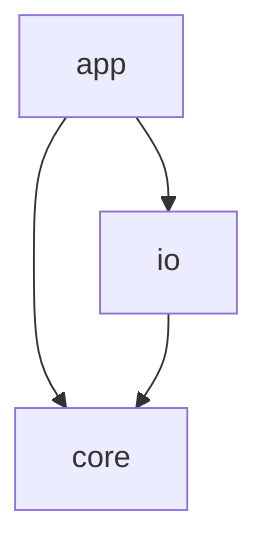

# <Project name> — initial overview (Phase 0 snapshot)
<!--
Written ONCE by the human and the architect at the end of Phase 0, after vision, milestones, modules and contracts exist.
Purpose: a single readable picture of what we set out to build and why, frozen as the baseline.
After it is frozen, NOBODY edits it. Changes in direction go into ADRs, and the living picture is docs/human/overview.md.
At every milestone end the architect compares the project against this file (drift check) and reports deviations in the PR.
Keep it to 1–2 screens. Link to the detailed files; do not copy them.
-->

## 1. What and why
<3–5 sentences: the problem, who has it, what this project does about it.>

## 2. Users / players and the core experience
- Primary user: <who>
- The one thing they must be able to do: <core loop / core use case>

## 3. Scope
| In scope (v1) | Out of scope (non-goals) |
|---|---|
| <item> | <item> |

## 4. Stack and constraints
- Language / engine / framework: <+ versions>
- Platforms: <...>
- Hard constraints: <performance, size, budget, offline, licensing>
- Stack profiles in use: <python / rust / unity / unreal / web-design-system>

## 5. Architecture at a glance
<One paragraph: the shape of the system and the main idea behind the split.>

| Module | Responsibility | Depends on |
|---|---|---|
| <name> | <one line> | <names> |

Details: `docs/ai/modules.yaml`, `docs/ai/contracts/`, `docs/architecture/`.

## 6. Plan
| Milestone | Goal | Done when |
|---|---|---|
| M1 | <walking skeleton> | <observable result> |
| M2 | <...> | <...> |

Details: `docs/plan/milestones.md`.

## 7. Key decisions at the start
- ADR-0001 <title> — <why, one line>

## 8. Risks and unknowns
| Risk / unknown | Likelihood | Plan |
|---|---|---|
| <...> | low/med/high | <spike ticket, fallback, accept> |

## 9. How we will know it worked
- <measurable success criteria for v1>

## 10. Drift log (architect appends one line per milestone; the only part edited after freezing)
| Milestone | Deviation from this baseline | ADR |
|---|---|---|
