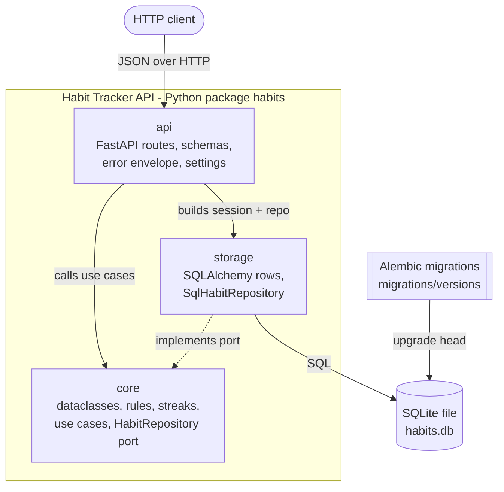

# Habit Tracker API — initial overview (Phase 0 snapshot)
<!--
Written ONCE by the human and the architect at the end of Phase 0. After it is frozen, NOBODY edits sections 1–9.
Changes in direction go into ADRs; the living picture is docs/human/overview.md. Drift is logged in section 10.
-->

## 1. What and why
People who want to build habits need a quick way to say "done today" and see whether they are keeping it up.
This project is a small self-hosted HTTP API for one user: habits that are daily or "N times per week",
one check-in per day, and streak/progress stats. It doubles as a reference for a clean core / storage / API split
with a hand-written OpenAPI contract, a locked dependency set and Alembic migrations.

## 2. Users and the core experience
- Primary user: one person calling the API from scripts, phone shortcuts or a future UI.
- The one thing they must be able to do: check a habit in for today and see the current streak and this period's progress.

## 3. Scope
| In scope (v1) | Out of scope (non-goals) |
|---|---|
| Habits CRUD, archive | Auth, multiple users, sharing |
| Daily and weekly-target (1..7) habits | Per-weekday schedules, several check-ins per day |
| Check-in / undo / list by date range | Reminders, notifications |
| Stats: current + longest streak, period progress | UI, import/export |
| SQLite + Alembic migrations, uv.lock | Other DBs, async drivers, scaling |

## 4. Stack and constraints
- Python 3.12 · FastAPI · Pydantic v2 · SQLAlchemy 2 (sync) · Alembic · SQLite · uv (`uv.lock`) · pytest · ruff · pyright.
- Platforms: Windows, Linux, macOS. "Today" in one configured time zone (`HABITS_TIMEZONE`, default UTC).
- Hard constraints: domain code is pure (no I/O, no clock); dependencies only via the architect.
- Stack profiles in use: python.

## 5. Architecture at a glance
Three layers in one package `habits`. `core` owns the domain types, rules, streak math, use cases and the
`HabitRepository` port; `storage` implements that port with SQLAlchemy and owns the migrations; `api` is FastAPI
wiring that parses JSON, injects the clock and a per-request session, calls core use cases and maps domain errors to
one error envelope. Arrows only point inward to core; a test enforces it.

| Module | Responsibility | Depends on |
|---|---|---|
| core | dataclasses, errors, validation, streaks, use cases, repository port | — |
| storage | engine/session, ORM rows, SqlHabitRepository, Alembic migrations | core |
| api | settings, app factory, schemas, routes, error envelope | core, storage |

Details: `docs/ai/modules.yaml`, `docs/ai/contracts/` (`openapi.yaml`, `core.pyi`, `storage.pyi`, `api.pyi`), `docs/architecture/`.

## 6. Plan
| Milestone | Goal | Done when |
|---|---|---|
| M1 | Walking skeleton: habits CRUD end to end | migration 0001 + drift test, `/health` + `/habits*` per contract, error envelope, boundary test |
| M2 | Check-ins, streaks, stats | migration 0002, check-in + stats endpoints, ADR-0005 rules tested, full contract test |

Details: `docs/plan/milestones.md`.

## 7. Key decisions at the start
- ADR-0001 Python 3.12 + FastAPI + SQLite, locked with uv — typed, OpenAPI, zero-ops DB, reproducible worktrees.
- ADR-0002 core / storage / api with the port in core; single user, no auth — pure, DB-free domain tests.
- ADR-0003 SQLAlchemy 2 sync + Alembic, explicit migrations, drift test — one schema source, checked on every gate.
- ADR-0004 Contract-first OpenAPI + one error envelope — fixed target for workers and clients.
- ADR-0005 Daily/weekly frequency and streak rules with grace for the current period.

## 8. Risks and unknowns
| Risk / unknown | Likelihood | Plan |
|---|---|---|
| Alembic autogenerate diff noise on SQLite (types, server defaults) makes the drift test flaky | med | handled in the migration ticket: compare with `compare_type=True`, fix the ORM/migration until diff is `[]` |
| FastAPI-generated OpenAPI differs in shape (names, 422s) from the YAML | med | contract test compares paths, methods, status codes and `$ref` names only; accept |
| Two parallel tickets add Alembic revisions → two heads | low | `migrations/**` is a lock resource; one migration ticket per milestone |
| Time-zone edge cases for "today" | low | clock injected; tests pin `today`; accept |
| SQLite single-writer locking under concurrent requests | low | single user; accept |

## 9. How we will know it worked
- All four gates green on `int/M2`; contract and drift tests pass.
- A fresh clone runs `uv sync --frozen`, `uv run alembic upgrade head`, `uv run uvicorn habits.api.app:app`
  and completes create habit → check in → stats with curl.

## 10. Drift log (architect appends one line per milestone; the only part edited after freezing)
| Milestone | Deviation from this baseline | ADR |
|---|---|---|
